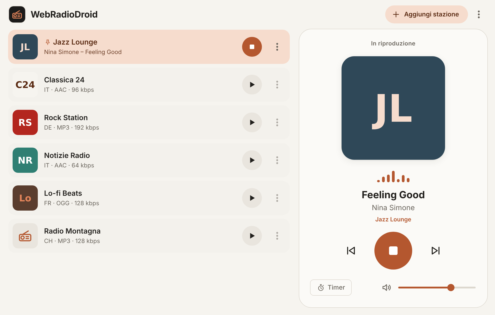
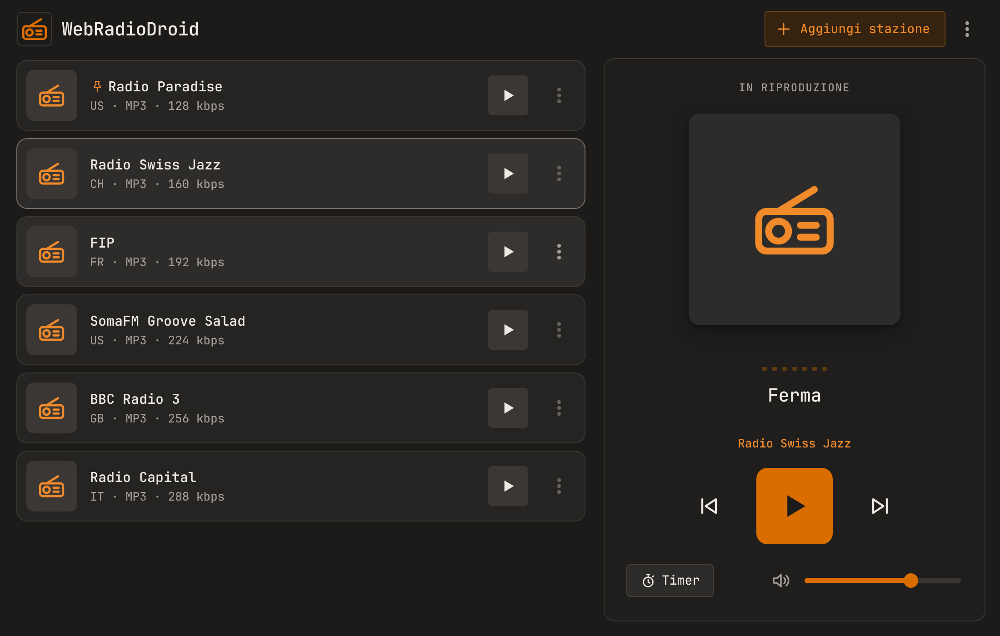
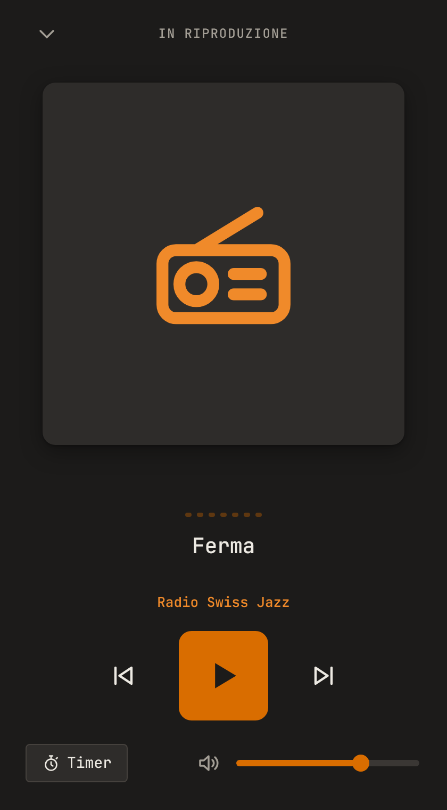

<p align="center">
  
</p>

<h1 align="center">WebRadioDroid</h1>

<p align="center">
  Webradio semplice per <b>telefono Android</b>, <b>Android Auto</b>, <b>Windows</b> e <b>Linux</b>.<br>
  Migliaia di stazioni da radio-browser.info, titolo del brano in onda, timer di spegnimento, tema chiaro e scuro con il colore principale che preferisci.
</p>

<p align="center">
  <a href="https://github.com/thamichele/webradiodroid/releases/latest"><b>⬇ Scarica l'ultima versione</b></a>
  ·
  <a href="#scaricare-lapp">Quale file scegliere</a>
  ·
  <a href="#come-si-usa">Come si usa</a>
</p>

<p align="center">
  
</p>

## Cosa fa
- **Cerca le stazioni per nome** nell'archivio libero [radio-browser.info](https://www.radio-browser.info), oppure aggiungi un link di streaming (anche playlist `.m3u` e `.pls`).
- **Mostra il brano in onda** (titolo e artista) quando la stazione lo trasmette.
- **Visualizzatore audio in tempo reale** nel player: le barre seguono la musica che stai ascoltando, dai bassi agli acuti (senza chiedere il permesso del microfono).
- **Loghi delle stazioni** cercati in automatico quando mancano, visibili anche in Android Auto.
- **Preferiti a modo tuo**: fissa in cima le stazioni che ascolti di più, rinominale o rimuovile.
- **Colore a scelta**: arancio, viola, rosso, giallo, blu o verde, dalle impostazioni (telefono) o dal menu ⋮ (computer).
- **Timer di spegnimento**: allo scadere la radio si ferma (sul telefono l'app si chiude del tutto, per risparmiare batteria).
- **Android Auto** con il player standard dell'auto, nei colori dell'app.
- **Notifica** con barra di avanzamento per ogni brano (telefono) e **tasti multimediali** della tastiera (computer).
- Nessuna pubblicità, nessun account, nessun tracciamento.

## Scaricare l'app
Tutti i file sono nella pagina [**Releases**](https://github.com/thamichele/webradiodroid/releases/latest), sotto *Assets*.
Al posto di `<versione>` trovi il numero della versione, per esempio `2.2.0`.

| Dispositivo | File da scaricare | Come installarlo |
|---|---|---|
| 📱 **Android** (consigliato) | repository F-Droid | ricevi gli aggiornamenti in automatico, vedi [sotto](#android-con-f-droid) |
| 📱 **Android** | `WebRadioDroid-<versione>.apk` | aprilo sul telefono e consenti l'installazione da questa fonte |
| 🪟 **Windows 10 / 11** | `WebRadioDroid-<versione>-windows-setup.exe` | installazione classica, con icona nel menu Start e sul desktop |
| 🪟 **Windows** senza installare | `WebRadioDroid-<versione>-windows-portable.exe` | si avvia con un doppio clic, anche da una chiavetta USB |
| 🐧 **Linux** (tutte le distribuzioni) | `WebRadioDroid-<versione>-linux-x86_64.AppImage` | rendilo eseguibile (*Proprietà → Permessi*, oppure `chmod +x`) e aprilo |
| 🐧 **Debian, Ubuntu, Mint** | `WebRadioDroid-<versione>-linux-amd64.deb` | `sudo apt install ./WebRadioDroid-<versione>-linux-amd64.deb` |

### Android con F-Droid
1. Installa [F-Droid](https://f-droid.org) se non ce l'hai.
2. In F-Droid apri **Impostazioni → Repository → +** e incolla questo indirizzo:
   ```
   https://raw.githubusercontent.com/thamichele/webradiodroid/fdroid/repo?fingerprint=A74A4581EC645FDF407BD01ECCB23353049B2110B4648C8FF94D8BB8D17A78D2
   ```
3. Cerca **WebRadioDroid** e installala. Gli aggiornamenti arrivano da soli.

### Android Auto
Android Auto mostra le app installate fuori dal Play Store solo dopo aver attivato **Origini sconosciute**:
nelle impostazioni di Android Auto tocca più volte *Versione* per sbloccare le impostazioni sviluppatore,
poi dal menu ⋮ → **Impostazioni sviluppatore** → attiva **Origini sconosciute**.

### Windows: avviso SmartScreen
I file per Windows non sono firmati con un certificato Microsoft a pagamento, quindi al primo avvio Windows può mostrare
*"Windows ha protetto il PC"*: clicca **Ulteriori informazioni → Esegui comunque**. Puoi controllare che il file sia quello originale
con l'impronta SHA-256 (vedi [Verifica integrità](#verifica-integrità)).

## Come si usa
**Sul telefono**
- Tocca **Aggiungi stazione**, cerca per nome o incolla un link, poi tocca la stazione per ascoltarla.
- Tocca la scheda della stazione in ascolto per aprire il **player a schermo intero**.
- **Tieni premuto** su una stazione per fissarla in cima, rinominarla o rimuoverla.

**Sul computer**
- **Aggiungi stazione** in alto a destra: scrivi il nome della radio oppure incolla un link, poi **Aggiungi**.
- **Clic** su una stazione per ascoltarla, **clic destro** (o ⋮) per fissarla in cima, rinominarla, aprire il suo sito o rimuoverla.
- **Barra spaziatrice** per avviare o fermare; i **tasti multimediali** della tastiera funzionano anche con la finestra in secondo piano.
- **Timer** sotto il player per lo spegnimento automatico. L'app segue il tema chiaro o scuro del sistema.

**Portare le stazioni dal telefono al computer**
1. Sul telefono: **Impostazioni → Esporta M3U** e salva o condividi il file.
2. Sul computer: menu ⋮ in alto a destra → **Importa stazioni (M3U)** e scegli il file.

Funziona anche al contrario: dal computer **Esporta stazioni (M3U)** crea lo stesso tipo di file.

## Screenshot
| Computer, tema chiaro | Computer, tema scuro | Finestra stretta |
|---|---|---|
|  |  |  |

## Verifica integrità
- **APK Android**: impronta SHA-256 del certificato di firma, uguale per tutte le versioni:
  `6f:57:e2:9c:92:99:49:18:23:e1:9d:a5:e6:88:17:5f:62:2a:e1:4a:40:4b:7f:bb:2f:42:90:42:21:40:05:b0`
- **Ogni file** della release (APK, Windows, Linux) ha accanto un file `.sha256` con la sua impronta.
  Per controllarla: su Linux `sha256sum -c <file>.sha256`, su Windows (PowerShell) `Get-FileHash <file>` e confronta il valore.

## Licenza e crediti
WebRadioDroid è basata su [Transistor](https://codeberg.org/y20k/transistor) di Y20K ed è distribuita con licenza MIT (vedi [`LICENSE.md`](LICENSE.md)).
L'elenco delle stazioni viene da [radio-browser.info](https://www.radio-browser.info), un archivio libero mantenuto dalla comunità.
